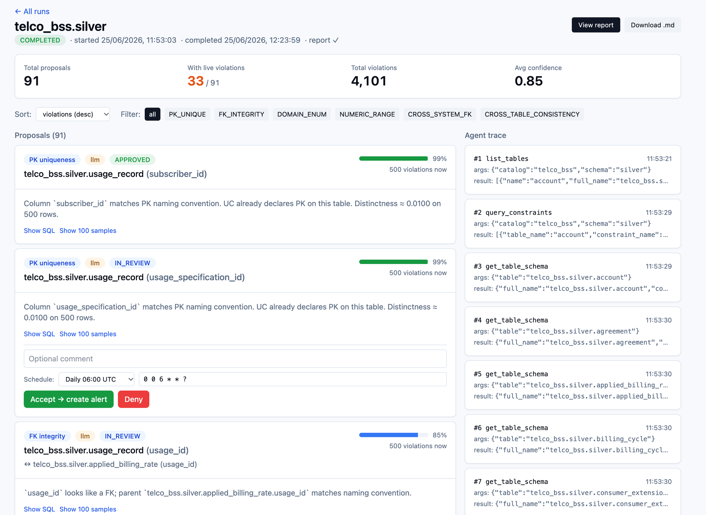
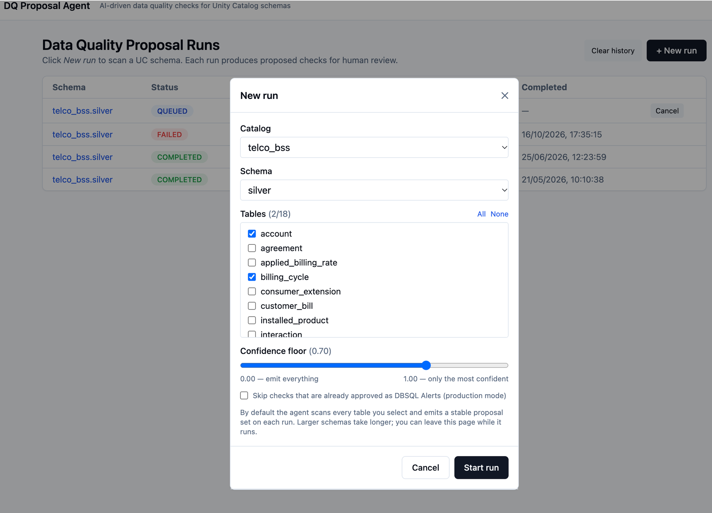
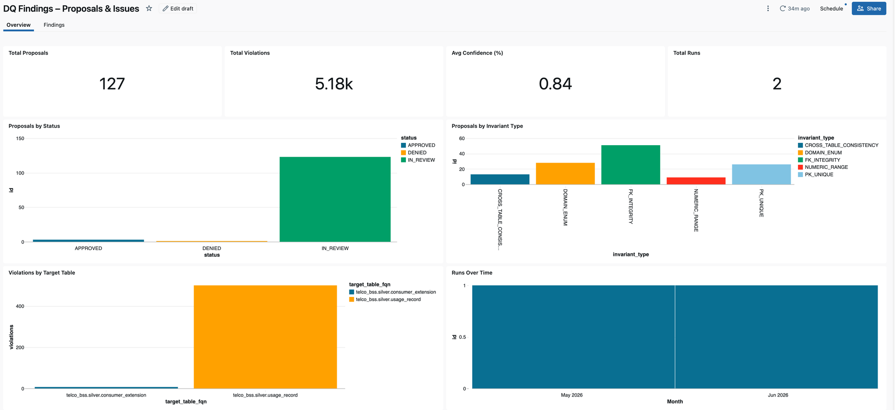
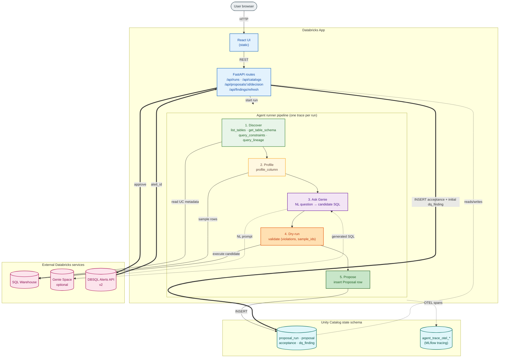

# Agentic Data Consistency

[](https://databricks.com)
[](https://docs.databricks.com/en/data-governance/unity-catalog/index.html)
[](https://docs.databricks.com/en/dev-tools/databricks-apps/index.html)

**dq-proposal-agent** is a Databricks App that scans a Unity Catalog schema, proposes data-quality checks for human review, and — on approval — creates a real Databricks SQL Alert so violations get caught going forward. No customer needs to write SQL.

The agent infers 6 invariant types from declared constraints, column lineage, and lightweight profiling, then asks Genie to author the validation SQL. Every candidate goes through a shape-validated dry-run on live data before becoming a proposal.

- **`docs/ACTIVATING_GENIE.md`** — how to set up Genie, check that it's being used, and fix the fallback-to-templates cases.
- **`docs/ROADMAP.md`** — features wired but intentionally deferred (ontology, DQX backend, smarter cross-system detection).
- **`docs/AUTHORIZATION.md`** — OBO vs. service-principal mode, app OAuth scopes, required grants, and how to switch between the modes.

## Highlights

- **6 invariant types** auto-discovered: PK_UNIQUE, FK_INTEGRITY, DOMAIN_ENUM, NUMERIC_RANGE, CROSS_TABLE_CONSISTENCY, CROSS_SYSTEM_FK.
- **Genie generates the SQL** from per-invariant NL prompts; hand-authored fallbacks cover the case where Genie is unreachable. The fallback is silent — see `docs/ACTIVATING_GENIE.md` to verify which path a run took.
- **OBO or service-principal identity** — `DQ_AUTH_MODE=obo|sp` decides whether scans and Genie calls run as the signed-in user or the app SP (`docs/AUTHORIZATION.md`).
- **Dry-run shape gate** — every candidate SQL must return `(violations BIGINT, sample_ids ARRAY<STRING>)` against live data before becoming a proposal. No path emits unvalidated SQL.
- **One-click DBSQL Alerts** on approval — the app SP creates the alert with the requesting user as email subscriber.
- **Auto-generated markdown report** per run, persisted to a UC volume; viewable / printable in-app.
- **Lakehouse Monitor reuse** — if a Quality Monitor exists on a table, `profile_column` reads its `*_profile_metrics` rows instead of issuing fresh sampled SELECTs.
- **Table-lineage fallback** — when `system.access.column_lineage` is empty, falls back to `system.access.table_lineage` so cross-system detection still works.
- **MLflow tracing** — every tool call is a child span; queryable as Delta tables in UC.
- **Cancel / clear-history** from the UI; reproducible runs by default (toggleable dedup against already-approved checks).
- **4-way parallel materialise** — Genie calls run concurrently up to `genie_concurrent_cap`.

## Screenshots

**Run page.** Each proposal shows the invariant type, its provenance badge (`llm` = SQL written by Genie), confidence, and how many rows violate it right now. Approving a proposal creates a DBSQL Alert. The agent trace on the right lists every tool call.



**New run.** Pick a catalog, schema and tables, and set the confidence floor.



**Dashboard.** An AI/BI dashboard over the app's state tables: proposals by status and invariant type, runs over time, and violations for approved checks (per table, from each check's latest refresh). A second page lists every finding. See [Dashboard](#dashboard) to install it.



---

## Architecture



**How to read it:** colours encode role. Green = read UC metadata; yellow = profile data; purple = call the LLM (Genie); orange = validate (dry-run on real data); dark green = persist. Pink = external Databricks services. Cyan = Unity Catalog state. Solid arrows = synchronous request flow; dashed = LLM/tracing background paths; thick arrows = the accept flow.

The runner is **not** a free-form LLM tool-call loop. It's a deterministic discovery pipeline that calls Genie only for SQL generation. Each `(invariant × target)` candidate gets a per-invariant NL prompt, Genie's SQL goes straight into `dry_run_check`, and only SQL whose result has the canonical shape `(violations BIGINT, sample_ids ARRAY<STRING>)` is persisted as a proposal. Hand-authored fallback templates in `apps/dq-proposal-agent/backend/src/agent/invariant_catalog.py` cover the case where Genie is unreachable or returns nothing — so the safety net guarantees a syntactically-correct proposal regardless of LLM availability.

---

## Installation Guidelines

The repo is a Databricks Asset Bundle. It deploys:

| Resource | What |
|---|---|
| App `dq-proposal-agent` | The agent (`apps/dq-proposal-agent/backend/`), with the SQL warehouse bound as resource `warehouse` |
| Job `setup` | Runs `notebooks/01_setup_grants.py`: creates the state schema and `reports` volume and grants the app's service principal access |
| Dashboard `DQ Findings – Proposals & Issues` | AI/BI dashboard over the app's state tables (`dashboards/dq_findings.lvdash.json`) |

You need a recent Databricks CLI, Node 20+ with `yarn` (to build the UI), an existing catalog for the app's state, and permission to grant on it.

### 1. Configure for your workspace

Before the first deploy to a new workspace:

1. **Fill in the `<placeholders>` in `apps/dq-proposal-agent/backend/app.yaml`**: `DQ_APP_CATALOG`/`DQ_APP_SCHEMA`, the Genie space ID (leave it empty to use the SQL templates), the alert subscriber email, and the SP-specific `DQ_ALERT_PARENT_PATH`/`DQ_MLFLOW_EXPERIMENT_NAME` paths (you get the SP ID after the first deploy, see step 2). The SQL warehouse isn't set in `app.yaml`: the bundle binds it as app resource `warehouse`.
2. **Pick the identity mode** (`DQ_AUTH_MODE`). For OBO, also add user-authorization scopes on the app, including **`genie`**. → `docs/AUTHORIZATION.md`
3. **Create and share the Genie space**, then set `DQ_GENIE_SPACE_ID`. → `docs/ACTIVATING_GENIE.md`
4. Deploy (below), then check `/api/health` and confirm that a test run's proposals came from Genie.

Bundle variables (pass with `--var name=value`, or set them under a target in `databricks.yml`):

| Variable | Default | What |
|---|---|---|
| `warehouse_id` | lookup of `Shared Unity Catalog Serverless` | Warehouse for the app and the dashboard |
| `app_catalog` / `app_schema` | `main` / `dq_app` | State location. Must match `DQ_APP_CATALOG` / `DQ_APP_SCHEMA` in `app.yaml` |
| `target_catalog` / `target_schema` | empty | Schema the agent should scan. The setup job grants the app SP read access on it |

### 2. Deploy with the bundle

```bash
./scripts/build_frontend.sh                       # builds the UI into apps/dq-proposal-agent/backend/static/

databricks bundle deploy -p <profile> \
  --var app_catalog=<app-catalog> --var app_schema=<app-schema> \
  --var target_catalog=<catalog-to-scan> --var target_schema=<schema-to-scan>

databricks bundle run setup -p <profile> <same --var flags>      # schema, volume, grants
databricks bundle run dq_proposal_agent -p <profile>             # deploys the source and starts the app
```

The setup job prints the app's service principal client ID. Put it in the `DQ_ALERT_PARENT_PATH` and `DQ_MLFLOW_EXPERIMENT_NAME` paths in `app.yaml`, then run `databricks bundle deploy` and `databricks bundle run dq_proposal_agent` again.

You can also deploy from the workspace: clone this repo as a Git folder, open the Asset Bundle editor and click **Deploy**, then run the `setup` job from the Deployments tab (🚀). The workspace deploy does not build the UI: without `backend/static/` the app serves only its API, so use the CLI path above if you need the web UI.

### 3. Check it

Open the app URL and call `/api/health`: `genie_configured` should be `true` if you set a Genie space, and `effective_identity` shows which identity the app runs as. Start a run and check that the proposals' SQL `source` is `genie`, not `template`.

To remove everything the bundle deployed, run `scripts/cleanup.sh`.

### Manual deploy (without the bundle)

If you can't use the bundle, deploy the app with the CLI. The deploy target is `apps/dq-proposal-agent/backend/` (it contains `app.yaml`). Build the frontend into `backend/static/`, then sync and deploy:

```bash
# Build frontend into apps/dq-proposal-agent/backend/static/
./scripts/build_frontend.sh

# Sync source to your workspace
cd apps/dq-proposal-agent/backend
databricks sync . /Workspace/Users/<you>/dq-proposal-agent \
  --exclude .venv --exclude __pycache__ --exclude .env --exclude '*.pyc' \
  -p <profile>

# ⚠️ Static gotcha: backend/static/ is in .gitignore, and `databricks sync`
# respects gitignore. So the line above does NOT push the built React frontend.
# Push it explicitly:
databricks workspace import-dir static \
  /Workspace/Users/<you>/dq-proposal-agent/static \
  --overwrite -p <profile>

# Create the app (one-time) and bind the warehouse resource
databricks apps create dq-proposal-agent -p <profile>
databricks apps update dq-proposal-agent --json '{"name":"dq-proposal-agent","resources":[{"name":"warehouse","sql_warehouse":{"id":"<warehouse-id>","permission":"CAN_USE"}}]}' -p <profile>

# Deploy
databricks apps deploy dq-proposal-agent \
  --source-code-path /Workspace/Users/<you>/dq-proposal-agent \
  -p <profile>
```

### Grants (reference)

The grants below are for **SP mode** (`DQ_AUTH_MODE=sp`). In **OBO mode** the users' group needs the data, state, and Genie grants instead, and the SP keeps its state-schema and alert-folder grants for startup and alert creation. Full matrix: `docs/AUTHORIZATION.md`.

The app's service principal needs grants on the state schema, the target data schema, and (for the Monitor reuse path) any `*_monitoring` schemas you want the agent to consume. The bundle's `setup` job runs these for you (`notebooks/01_setup_grants.py`). To run them by hand from a SQL editor or notebook, replace the placeholders:

```sql
-- State + target data
GRANT USE CATALOG ON CATALOG <app_catalog>                                            TO `<app-sp-client-id>`;
GRANT USE SCHEMA, CREATE TABLE, CREATE VOLUME, SELECT, MODIFY
  ON SCHEMA <app_catalog>.<app_schema>                                                TO `<app-sp-client-id>`;
GRANT USE SCHEMA, SELECT ON SCHEMA <target_catalog>.<target_schema>                   TO `<app-sp-client-id>`;

-- Lakehouse Monitor profile re-use (optional, only if you've configured Monitors).
-- Without this grant, the SDK returns a `__db_internal_permission_denied` sentinel
-- as the metrics-table name and the agent silently falls through to sampled SELECTs.
GRANT USE SCHEMA, SELECT ON SCHEMA <target_catalog>.<target_schema>_monitoring        TO `<app-sp-client-id>`;
```

Find `<app-sp-client-id>` in the output of `databricks apps get dq-proposal-agent -p <profile>` (field `service_principal_client_id`).

If Genie is configured, the calling identity also needs **Can Run** on the Genie space and **Can Use** on the space's warehouse. Otherwise every proposal falls back to the templates.

The app's `lifespan` startup hook also flips any stale `RUNNING` / `QUEUED` rows in `proposal_run` to `FAILED` — so an interrupted deploy never leaves "ghost" runs in the UI.

---

---

## Local development

### Prerequisites

- Python 3.11+ (3.14 used in dev; SDK / FastAPI work fine on 3.11+).
- Node 20+ and `yarn`.
- Databricks CLI ≥ 0.229.0, authenticated against a workspace where you have:
  - A SQL warehouse with `CAN_USE`.
  - A target schema you have `SELECT` on (the agent scans this).
  - A schema you have `CREATE TABLE` on (the app's state schema — agent writes runs/proposals/findings here).
  - Optionally: a Genie space the agent can call for NL→SQL.

### One-time setup

```bash
# Backend deps
cd apps/dq-proposal-agent/backend
python -m venv .venv
.venv/bin/pip install -r requirements.txt
cp .env.example .env   # then fill in
cd -

# Frontend deps
cd apps/dq-proposal-agent/frontend
yarn install
cd -
```

Required env vars (see `apps/dq-proposal-agent/backend/.env.example` for the full list with comments):

| Var | What |
|---|---|
| `DQ_DATABRICKS_PROFILE` | CLI profile to authenticate as |
| `DQ_DATABRICKS_WAREHOUSE_ID` | SQL warehouse for all agent queries + state |
| `DQ_APP_CATALOG` / `DQ_APP_SCHEMA` | Where the agent stores state tables (and report files in a `/Volumes/<catalog>/<schema>/reports` volume) |
| `DQ_GENIE_SPACE_ID` | Optional. Falls back to hand-authored SQL templates if empty or unreachable. Setup: `docs/ACTIVATING_GENIE.md` |
| `DQ_AUTH_MODE` | `obo` (default) or `sp`. Which identity request handlers act as — see `docs/AUTHORIZATION.md` |
| `DQ_GENIE_CONCURRENT_CAP` | Default 4. Max worker threads in the parallel materialise loop |
| `DQ_DEFAULT_ALERT_SUBSCRIBERS` | Default email for created alerts |
| `DQ_ALERT_PARENT_PATH` | Workspace folder where alerts get created |
| `DQ_MLFLOW_EXPERIMENT_NAME` | Optional. Enables MLflow tracing to UC |
| `DQ_CONFIDENCE_FLOOR` | Default 0.7. Candidates with `base_confidence` below the floor are dropped pre-materialise. Per-run override in the New Run dialog |
| `DQ_DEDUP_ALREADY_ACCEPTED` | Default `false`. When `true`, runs skip `(invariant, table, columns)` signatures already approved. Reproducible-by-default; flip on for production scans |
| `DQ_USE_LAKEHOUSE_MONITOR_PROFILES` | Default `true`. Controls whether `profile_column` checks for a Lakehouse Monitor before sampling |

### Run

```bash
# Backend (auto-reloads)
cd apps/dq-proposal-agent/backend
.venv/bin/uvicorn src.main:app --reload --port 8000

# Frontend (separate terminal, proxies /api → :8000)
cd apps/dq-proposal-agent/frontend
yarn dev   # serves on :5173
```

Visit http://localhost:5173 and click **+ New run**.

### Run end-to-end via curl

```bash
curl -sS -X POST http://127.0.0.1:8000/api/runs \
  -H 'Content-Type: application/json' \
  -d '{"catalog":"<your-catalog>","schema":"<your-schema>","run_async":true,"table_filter":["<table>"]}'
```

---

---

## Project layout

```
agentic-data-consistency/
├── databricks.yml                 Asset Bundle: app, setup job, dashboard
├── apps/dq-proposal-agent/
│   ├── backend/                   deployed as the app source
│   │   ├── app.yaml               Databricks Apps manifest (fill in the placeholders)
│   │   ├── requirements.txt
│   │   ├── pyproject.toml
│   │   ├── .env.example
│   │   └── src/
│   │       ├── main.py            FastAPI app + lifespan (schema bootstrap, MLflow setup)
│   │       ├── auth.py            OBO / PAT / SP fallback for WorkspaceClient (DQ_AUTH_MODE)
│   │       ├── config.py          Pydantic settings (DQ_ env prefix)
│   │       ├── mlflow_setup.py    UC-backed MLflow tracing destination
│   │       ├── findings.py        Re-evaluate approved proposals, append to dq_finding
│   │       ├── routes/            runs, decisions, catalogs, findings, reports, admin
│   │       ├── agent/             runner, invariant_catalog (fallback SQL), genie_prompts,
│   │       │                      report, tools/ (schema, profiling, constraints, lineage,
│   │       │                      ask_genie, dry_run_check, query_ontology (deferred))
│   │       ├── clients/           sql_warehouse, genie_mcp, dbsql_alerts, report_writer,
│   │       │                      dqx_emitter (deferred), workspace
│   │       └── db/                ddl.sql, schema.py (Pydantic models), store.py
│   └── frontend/                  Vite + React + Tailwind
├── dashboards/
│   └── dq_findings.lvdash.json    AI/BI dashboard over the state tables
├── notebooks/
│   └── 01_setup_grants.py         State schema, reports volume, SP grants
├── scripts/
│   ├── build_frontend.sh          Build the UI into backend/static/
│   └── cleanup.sh                 `databricks bundle destroy`
└── docs/
    ├── architecture.png/.mmd
    ├── ACTIVATING_GENIE.md        Genie space setup + verifying Genie vs. template
    ├── AUTHORIZATION.md           OBO vs. SP, app scopes, grants, switching modes
    └── ROADMAP.md
```

---

## State the app creates in your workspace

In `<DQ_APP_CATALOG>.<DQ_APP_SCHEMA>`:

| Table | Purpose |
|---|---|
| `proposal_run` | One row per agent run. Columns: `id`, `status`, `iterations`, `agent_steps_json`, `report_path`, `cancel_requested` |
| `proposal` | One row per emitted proposal (invariant, target, validated SQL, violation count, status, reviewer) |
| `acceptance` | Links an approved proposal to its created DBSQL alert |
| `dq_finding` | Time series of evaluations (one row per agent refresh) — backs the dashboard |
| `agent_trace_otel_spans` + 5 siblings | MLflow tracing destination (one trace tree per run) |

Plus a UC volume at `/Volumes/<DQ_APP_CATALOG>/<DQ_APP_SCHEMA>/reports/` — one `<run_id>.md` per completed run.

DBSQL Alerts created on approval live under `<DQ_ALERT_PARENT_PATH>`.

## Dashboard

`dashboards/dq_findings.lvdash.json` is an AI/BI dashboard over the state tables above (`proposal`, `proposal_run`, `dq_finding`). Its queries use unqualified table names, so the dashboard's default catalog and schema decide which state tables it reads. The bundle sets them from `app_catalog` / `app_schema`. Without the bundle, create it with the CLI:

```bash
databricks lakeview create -p <cli-profile> \
  --display-name "DQ Findings – Proposals & Issues" \
  --warehouse-id <warehouse-id> --parent-path /Users/<you> \
  --dataset-catalog <app-catalog> --dataset-schema <app-schema> \
  --serialized-dashboard "$(cat dashboards/dq_findings.lvdash.json)"
```

Then open it, check the numbers and **Publish**. Whoever views it needs `SELECT` on the three tables and access to the warehouse.

## API surface

| Method | Path | What |
|---|---|---|
| `GET` | `/api/health` | Liveness, plus `genie_configured`, `auth_mode`, and `effective_identity` for the calling request (`user` / `app_sp`; `pat` / `profile` / `sdk_default` in local dev) |
| `GET` | `/api/catalogs` | List catalogs |
| `GET` | `/api/catalogs/{c}/schemas` | List schemas in a catalog |
| `GET` | `/api/catalogs/{c}/schemas/{s}/tables` | List tables in a schema (drives the table multi-select in the New Run dialog) |
| `GET` / `POST` | `/api/runs` | List runs / create a new run |
| `GET` | `/api/runs/{id}` | Get one run (status, iteration count, agent_steps trace) |
| `GET` | `/api/runs/{id}/proposals` | Proposals for a run |
| `POST` | `/api/runs/{id}/cancel` | Cooperative cancel — runner exits at next checkpoint |
| `POST` | `/api/proposals/{id}/decision` | Approve → alert / Deny |
| `GET` / `POST` | `/api/runs/{id}/report` | View / regenerate the markdown recommendation report. Accepts `?floor=<0-1>` to filter the appendix |
| `GET` | `/api/runs/{id}/report.md` | Download `.md` attachment |
| `POST` | `/api/findings/refresh` | Re-evaluate all approved proposals; append to `dq_finding` |
| `POST` | `/api/admin/clear-history` | `{"confirm": true}` — wipes the four state tables + `reports/` volume |

---

## Tests

No automated tests yet. The route surface is small enough that adding `pytest` against an in-memory store would be the natural first move; PR-worthy.

## Contributing

1. **git clone** this project locally
2. Utilize the Databricks CLI to test your changes against a Databricks workspace of your choice
3. Contribute to repositories with pull requests (PRs), ensuring that you always have a second-party review from a capable teammate

## 📄 Third-Party Package Licenses

&copy; 2026 Databricks, Inc. All rights reserved. The source in this project is provided subject to the Databricks License [https://databricks.com/db-license-source]. All included or referenced third party libraries are subject to the licenses set forth below.

| Package | License | Copyright |
|---------|---------|-----------|
| [fastapi](https://github.com/fastapi/fastapi) | MIT | Copyright (c) 2018 Sebastián Ramírez |
| [uvicorn](https://github.com/encode/uvicorn) | BSD-3-Clause | Copyright © 2017-present, Encode OSS Ltd. |
| [pydantic](https://github.com/pydantic/pydantic) | MIT | Copyright (c) 2017 to present Pydantic Services Inc. and individual contributors |
| [pydantic-settings](https://github.com/pydantic/pydantic-settings) | MIT | Copyright (c) 2022 Samuel Colvin and other contributors |
| [databricks-sdk](https://github.com/databricks/databricks-sdk-py) | Apache-2.0 | Copyright (2023) Databricks, Inc. |
| [httpx](https://github.com/encode/httpx) | BSD-3-Clause | Copyright © 2019, Encode OSS Ltd. |
| [python-multipart](https://github.com/Kludex/python-multipart) | Apache-2.0 | Copyright 2012, Andrew Dunham |
| [rdflib](https://github.com/RDFLib/rdflib) | BSD-3-Clause | Copyright (c) 2002-2025, RDFLib Team |
| [PyYAML](https://github.com/yaml/pyyaml) | MIT | Copyright (c) 2017-2021 Ingy döt Net, Copyright (c) 2006-2016 Kirill Simonov |
| [mlflow](https://github.com/mlflow/mlflow) | Apache-2.0 | Copyright 2018 Databricks, Inc. |
| [react](https://github.com/facebook/react), react-dom | MIT | Copyright (c) Meta Platforms, Inc. and affiliates |
| [react-router-dom](https://github.com/remix-run/react-router) | MIT | Copyright (c) React Training LLC 2015-2019, Copyright (c) Remix Software Inc. 2020-2021, Copyright (c) Shopify Inc. 2022-2023 |
| [@radix-ui/*](https://github.com/radix-ui/primitives) | MIT | Copyright (c) 2022 WorkOS |
| [class-variance-authority](https://github.com/joe-bell/cva) | Apache-2.0 | Copyright 2022 Joe Bell |
| [clsx](https://github.com/lukeed/clsx) | MIT | Copyright (c) Luke Edwards |
| [lucide-react](https://github.com/lucide-icons/lucide) | ISC | Copyright (c) for portions of Lucide are held by Cole Bemis 2013-2022 as part of Feather (MIT); all other copyright held by Lucide Contributors 2022 |
| [tailwind-merge](https://github.com/dcastil/tailwind-merge) | MIT | Copyright (c) 2021 Dany Castillo |
| [tailwindcss](https://github.com/tailwindlabs/tailwindcss) (build) | MIT | Copyright (c) Tailwind Labs, Inc. |
| [vite](https://github.com/vitejs/vite), @vitejs/plugin-react (build) | MIT | Copyright (c) 2019-present, VoidZero Inc. and Vite contributors |
| [typescript](https://github.com/microsoft/TypeScript) (build) | Apache-2.0 | Copyright (c) Microsoft Corporation |
| [postcss](https://github.com/postcss/postcss), [autoprefixer](https://github.com/postcss/autoprefixer) (build) | MIT | Copyright 2013 Andrey Sitnik |
